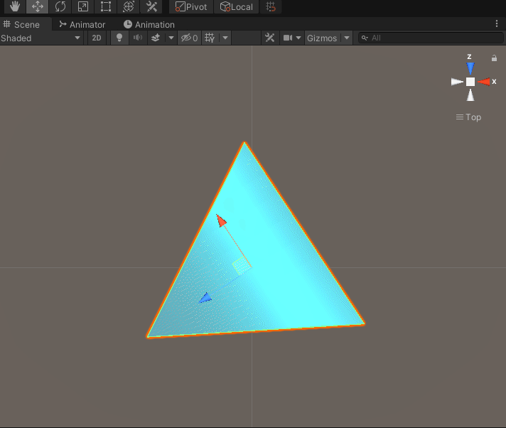
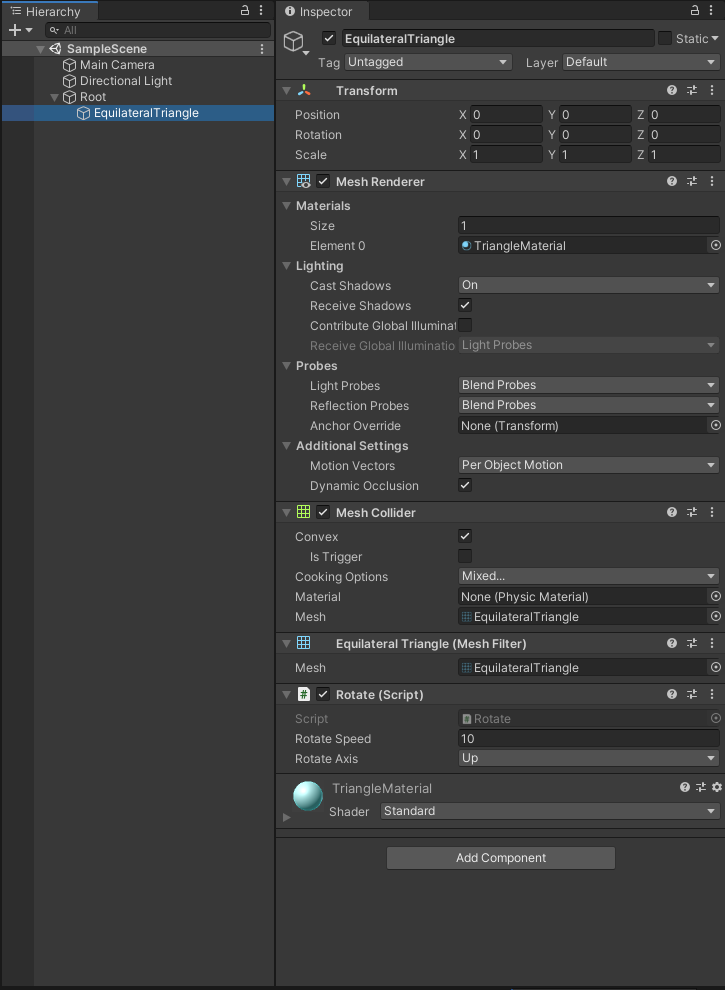
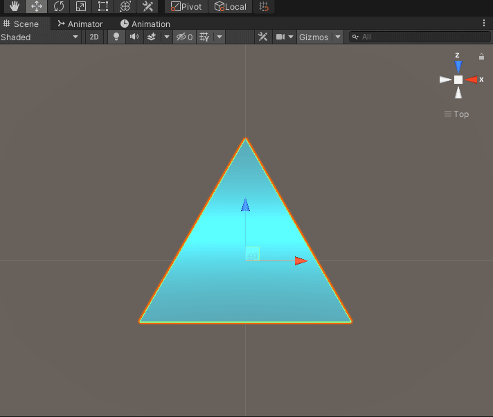
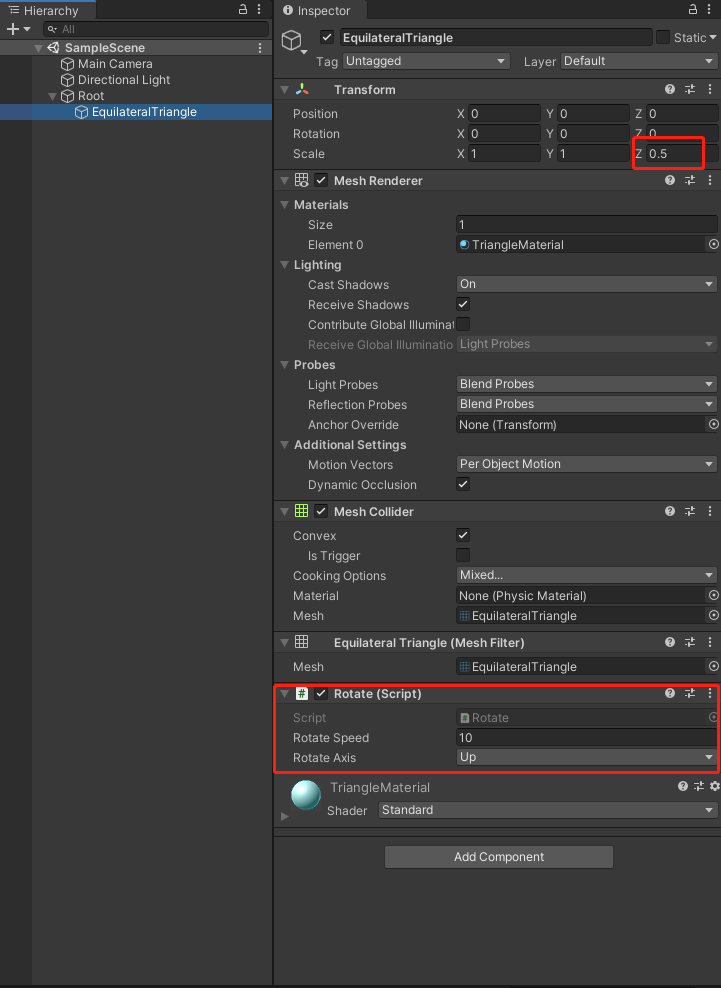
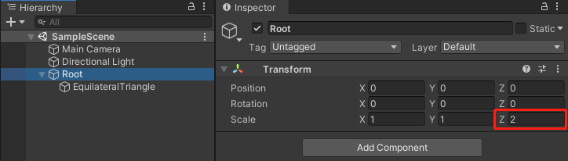
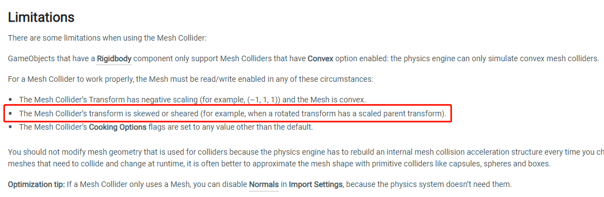

最近在工作的时候碰到了一个关于MeshCollider的问题，情况是这样的：需求是在游戏中存在一个绕自身Y轴旋转的三角形障碍，类似下图：<br/>
<br/><!--more-->
节点结构如下：<br/>
<br/>
旋转脚本也很简单：
```C#
using UnityEngine;

public class Rotate : MonoBehaviour
{
    public float RotateSpeed;
    public RotateAxis RotateAxis;

    // Update is called once per frame
    void Update()
    {
        var axis = Vector3.zero;
        switch (RotateAxis)
        {
            case RotateAxis.Up:
                axis = Vector3.up;
                break;
            case RotateAxis.Forward:
                axis = Vector3.forward;
                break;
            case RotateAxis.Right:
                axis = Vector3.right;
                break;
        }
        transform.Rotate(axis, Time.deltaTime * RotateSpeed);
    }
}

public enum RotateAxis
{
    Up,
    Forward,
    Right
}

```
实际情况要复杂一些，但是核心需求就是如此，神奇的是在实际运行后，发现MeshCollider和MeshRender在旋转时会出现有规律的**错位**，如下图：<br/>
<br/>
实际情况下没这么夸张的错位，但是还是比较明显的。当时十分费解，首先怀疑是旋转脚本的问题，把旋转逻辑从Update里转移到了协程里，发现还是有问题，又尝试使用DoTween动画去做，和料想的一样，依旧没有解决问题，
然后又尝试新建场景，进行尝试，使用相同的MeshCollider和MeshRender，发现错位问题没有了。。。:worried:<br/>
秉持着遇事不决查文档的态度，果断打开了官方文档[MeshCollider](https://docs.unity3d.com/Manual/class-MeshCollider.html)，看了半天没什么发现，那就只能开始大海捞针，寻找“志同道合”的朋友。
结果还真让我找到了[“志同道合”的朋友](https://gamedev.stackexchange.com/questions/63428/unity-mesh-and-collider-not-aligned-on-rotation)，恍然大悟，究其原因，是因为**当MeshCollider作为子节点时，其上层父节如果存在缩放**，那么此时对Collider进行旋转就会出现错位的现象，之后自己又进行了尝试，发现将Collider节点设置如下情况：<br/>
<br/>
将其父节点设置为：<br/>
<br/>
就会出现旋转错位，总结一下就是：<br>
对MeshCollider进行旋转时，当其父节点存在**对非旋转轴方向的缩放**时，就会出现与MeshRender**错位**的现象，如上述情况，绕Y轴旋转，父节点存在X或Z轴缩放时，就会出现错位。<br/>

找到了问题，就要解决问题了，按理来说，父节点不要缩放就可以了，但是实际情况是，父节点下有多个其他相关功能的节点，调整父节点缩放会影响其他子节点的显示，因为当时观察的时候发现，其实错位的时机是由规律可循的，也就是说每转一圈，两者是有重合的时刻的，并且与转了多少圈没有关系，结果试了半天，也没找到啥规律，所有放弃了，官方也没说是什么原因或者原理造成的，也没解决方案，但是庆幸的是经过高人指点，使用了一个非常之Trick的方法解决了这个问题：**在Update里失效再激活MeshCollider组件**，如下：

```C#
using UnityEngine;

public class Rotate : MonoBehaviour
{
    public float RotateSpeed;
    public RotateAxis RotateAxis;
    public MeshCollider Collider;

    // Update is called once per frame
    void Update()
    {
        Collider.enabled = false;
        Collider.enabled = true;

        var axis = Vector3.zero;
        switch (RotateAxis)
        {
            case RotateAxis.Up:
                axis = Vector3.up;
                break;
            case RotateAxis.Forward:
                axis = Vector3.forward;
                break;
            case RotateAxis.Right:
                axis = Vector3.right;
                break;
        }
        transform.Rotate(axis, Time.deltaTime * RotateSpeed);
    }
}

public enum RotateAxis
{
    Up,
    Forward,
    Right
}
```

到此，该问题得到了不太完美的解决，回头再看官方文档时，发现其实文档里是有说明这种情况：<br/>
<br/>
还是太不仔细了呀！绕了这么一大圈，所以在此记录以供警示！:warning:
